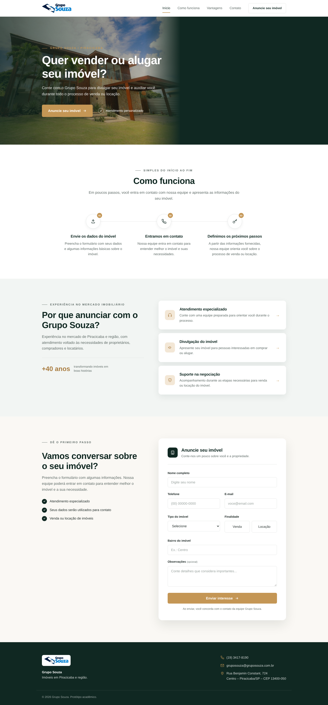
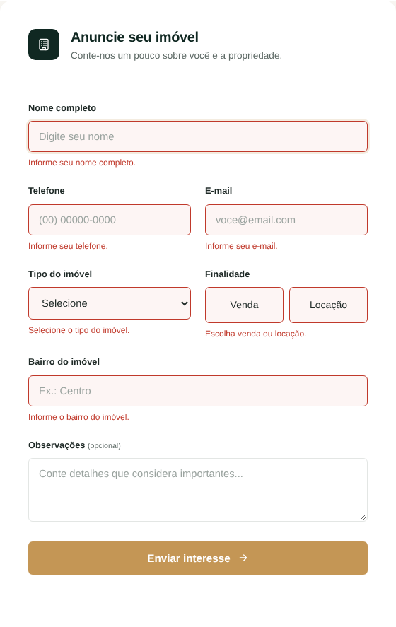
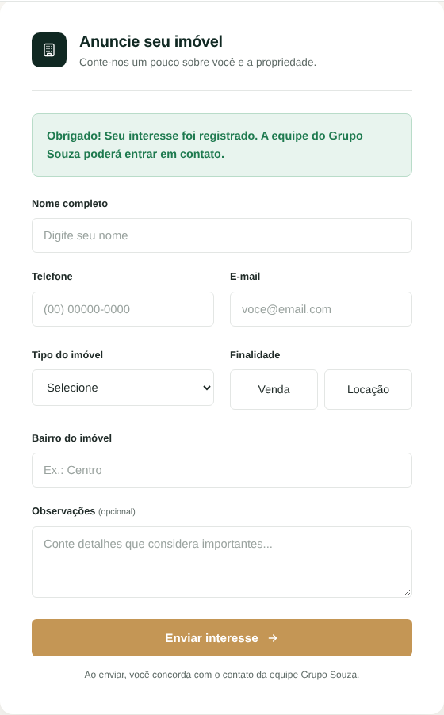

# Landing Page para Captação de Imóveis — Grupo Souza

Projeto desenvolvido para a disciplina **Projeto Interdisciplinar de Computação I (PIC I)**.

**Repositório:** https://github.com/matheus-moda23/grupo-souza-lp

## Objetivo

Este projeto é uma landing page acadêmica para o **Grupo Souza**, imobiliária de Piracicaba/SP.
A página apresenta a imobiliária e facilita o primeiro contato de proprietários interessados
em **vender ou alugar** seus imóveis, por meio de um formulário de interesse.

O envio do formulário é **simulado**: os dados são validados no navegador e uma mensagem
de confirmação é exibida, mas nenhuma informação é enviada a um servidor.

O projeto relaciona conteúdos de:

- Programação de Sistemas Web (HTML, CSS e layout responsivo);
- Lógica de Programação I e II (validações, condicionais, funções e eventos em JavaScript);
- Projeto Interdisciplinar de Computação I (do protótipo no Figma até a implementação).

## Integrantes

| Nome | RA |
|------|----|
| Matheus Moda Carcanholo | 202410167 |


## Tecnologias

- HTML5
- CSS3
- JavaScript (puro, sem frameworks)

## Instalação, configuração e execução

O projeto **não precisa de instalação nem de configuração**. Para executar:


1. Baixe ou clone o repositório:
   ```bash
   git clone https://github.com/matheus-moda23/grupo-souza-lp
   ```
   Ou extraia o arquivo `.zip` do projeto.
2. Abra a pasta `grupo-souza-lp`.
3. Abra o arquivo `index.html` em um navegador moderno (Chrome, Edge, Firefox ou Safari).

Observações:

- não existe instalação;
- não existem dependências para instalar;
- não é necessário banco de dados;
- não é necessário servidor.

## Funcionalidades

- Landing page responsiva (desktop, tablet e celular);
- Navegação entre seções pelo menu, com rolagem suave;
- Destaque no menu da seção que está sendo visualizada;
- Menu hambúrguer em telas pequenas;
- Botões "Anuncie seu imóvel" (CTA) que levam ao formulário;
- Formulário de interesse para venda ou locação;
- Validação dos campos obrigatórios (nome, telefone, e-mail, tipo do imóvel, finalidade e bairro);
- Validação de formato básico de e-mail;
- Máscara de telefone no formato `(19) 99999-9999` (também aceita fixo `(19) 3417-8190`);
- Mensagens de erro exibidas embaixo de cada campo, sem uso de `alert()`;
- Mensagem de sucesso após o envio e limpeza do formulário.

## Estrutura de pastas

```text
grupo-souza-lp/
├── index.html          # Estrutura da página
├── README.md           # Este arquivo
├── css/
│   └── style.css       # Estilos e responsividade
├── js/
│   └── script.js       # Menu, máscara de telefone e validação do formulário
├── assets/
│   ├── logo.png        # Logo do Grupo Souza
│   └── hero.jpg        # Imagem da seção principal
└── screenshots/
    └── *.png           # Capturas de tela da aplicação
```

## Requisitos e dependências

**Requisitos:**

- um navegador moderno (Google Chrome, Microsoft Edge, Mozilla Firefox ou Safari);
- conexão com a internet apenas para carregar a fonte (opcional).

**Dependências:** não existem dependências obrigatórias, bibliotecas ou pacotes para instalar.

A fonte **Manrope** é carregada pelo Google Fonts. Sem internet, o navegador usa
uma fonte padrão e o site continua funcionando normalmente.

## Imagens de funcionamento

### Página inicial (desktop)



### Validação do formulário

Ao tentar enviar com campos vazios ou inválidos, cada campo é destacado com uma mensagem curta:



### Envio com sucesso

Com os dados corretos, é exibida a mensagem de confirmação e o formulário é limpo:



### Versão para celular

Em telas pequenas, o menu vira um menu hambúrguer:


## Observação

Projeto com finalidade exclusivamente acadêmica. O formulário não envia dados reais
e não há integração com sistemas do Grupo Souza.

© 2026 Grupo Souza. Protótipo acadêmico.
